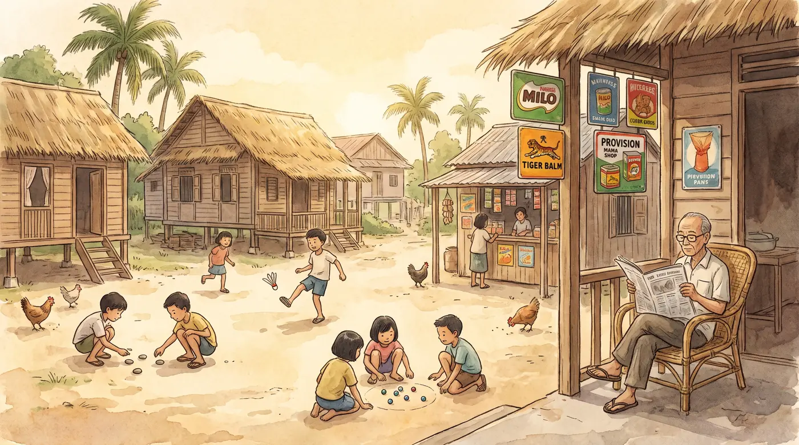

# Kampong Days · 甘榜童年

**Singapore heritage games for seniors, by Tzu Chi Foundation (Singapore).**

▶ **Play now:** https://tzuchi-singapore.github.io/Singapore-Heritage-Games/



Kampong Days brings back the games played on verandahs, void decks and five-foot ways, using the real rules. It is designed for seniors: big buttons and text, English and 中文, a gentle slow mode, and no sign-up or download. Every game finished unlocks a painted memory of old Singapore in the Memory Album.

## The games

| Category | Game | |
|---|---|---|
| Music & rhythm | **Getai Beats** | Tap to the beat of folk songs and heritage-style tunes, with 3 levels, combo celebrations, a selfie frame and a daily Top 20 |
| | **Dance Party** | Copy the arrows and hit the beat so your chosen 1960s couple (Chinese, Malay, Indian or Eurasian) dances 8 moves, from the Twist to the joget; 3 levels, daily Top 20 and a trophy selfie |
| Board games | **Congkak** | The Malay seed-sowing game |
| | **Snakes & Ladders** | Kampong edition: climb the ladders, dodge the snakes, hear the stories |
| | **Chinese Chess 象棋** | Play the computer or a friend |
| | **Draughts** | The kopitiam classic: compulsory captures, chain jumps and crowned kings |
| | **Reversi** | Trap and flip your opponent's discs; corners are precious |
| Skill & flick | **Five Stones** | Throw, pick up and catch with a hand you move |
| | **Pick-up Sticks** | Lift one stick without moving the others |
| | **Kuti Kuti** | Flick the plastic animals with a swipe |
| | **Goli** | Marbles: knock them out of the ring |
| | **Carrom** | The board turns to face each player |
| Puzzles & memories | **Memory Cards** | Flip and match old-school toys and treats (6, 8 or 12 pairs) |
| | **Spot the Difference** | Four heritage scenes with new changes every game (3, 5 or 7 to find) |
| | **Jigsaw Puzzle** | Scenes of old Singapore |
| | **Memory Album** | 60 paintings of Singapore's past to collect |

## Features
- **For seniors:** large text with A− / A+ (up to 170%), English and 中文, a slow-pace setting, and sound on or off.
- **Jump to bar:** category shortcuts at the top of the home page.
- **Play together:** the versus games (Congkak, Snakes & Ladders, Chinese Chess, Draughts, Reversi, Goli and Carrom) can be played against the computer (Chinese Chess, Draughts and Reversi have easy to hard levels), on one device, or online on two devices with a 4-digit code (the host taps Accept to start).
- **Works anywhere:** phones, tablets and computers, in any modern browser.

## Privacy
- There are no accounts, no tracking and no adverts.
- Progress, the Memory Album, settings and the daily Top 20 are saved only in the browser on each device.
- The camera is used only for the Getai Beats and Dance Party selfies. The photo stays on the device unless the player chooses to save it.
- Online play sends only game moves, through free public relays. No names or photos are sent.

## Project files
```
index.html               the whole app (code, styles and the online-play library)
img/                     illustrations, game pictures and Memory Album paintings
music/                   music tracks for Getai Beats and Dance Party
video/                   dance clips for Dance Party (MP4 with WebM backup)
vendor/                  an older library no longer used (see notices)
LICENSE                  licence terms
THIRD-PARTY-NOTICES.md   credits for software, fonts, services, pictures and music
```

The site is published with **GitHub Pages** from the `main` branch. Any change pushed to `main` goes live within a minute or two. Add `?v=` with any number to the address to skip an old copy cached by the browser.

## Credits
- Made for Tzu Chi Foundation (Singapore) senior wellness programmes.
- Pictures and music made with Higgsfield AI. The folk tracks are new arrangements of traditional songs.
- Online play uses MQTT.js (MIT). Fonts are from Google Fonts (SIL Open Font License).

See [THIRD-PARTY-NOTICES.md](THIRD-PARTY-NOTICES.md) for details.

## Licence
© 2026 Tzu Chi Foundation (Singapore). **All rights reserved.** Anyone is welcome to play the games at the official website, including in group activities at senior centres. Copying, reusing or republishing the code, pictures or music needs written permission. The Tzu Chi name and logo are not licensed for any use. See [LICENSE](LICENSE).
